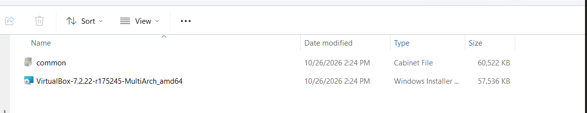
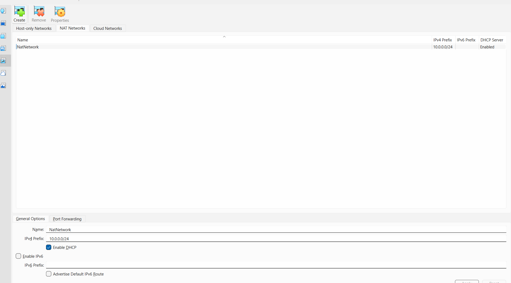
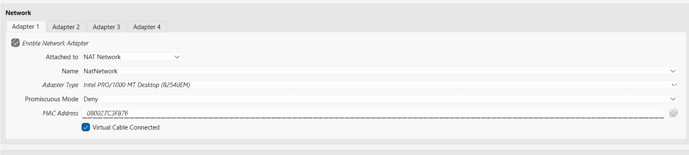
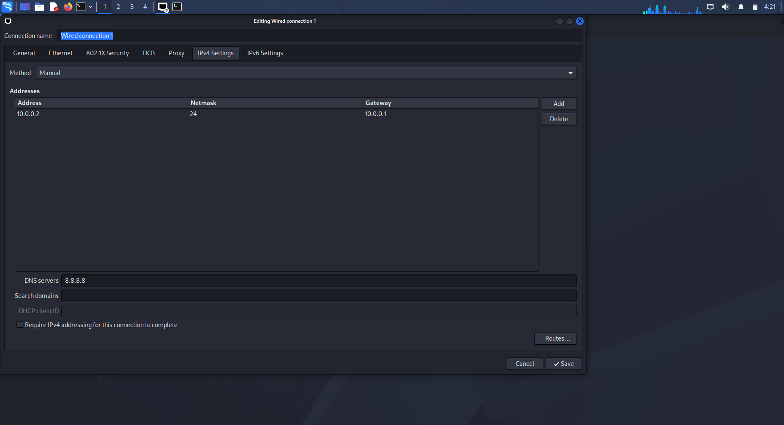
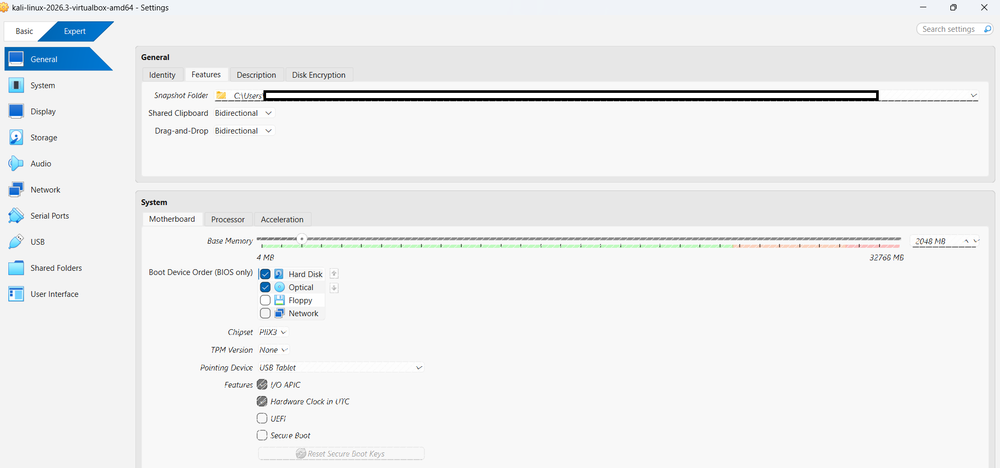
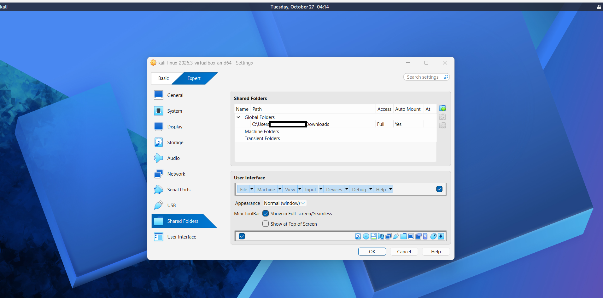
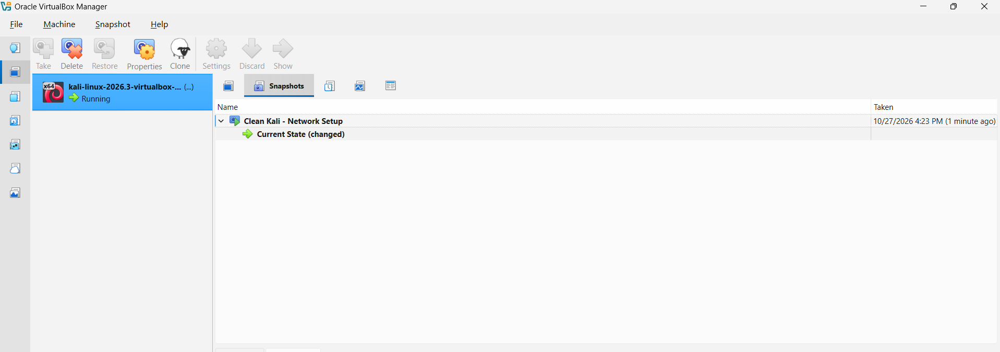
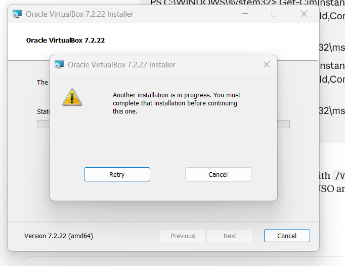

<div align="center">

# 🔐 Cybersecurity Lab Environment Setup
### Building an isolated virtual lab for penetration testing and ethical hacking practice

[](https://github.com)
[](https://github.com)
[](https://github.com)
[](https://github.com)
[](https://github.com)
[](https://github.com)
[](https://github.com)
[](https://github.com)
[](https://github.com)
[](https://github.com)

</div>

---

## 📌 Project Overview
This project details the deployment of a virtual penetration-testing lab using Oracle VirtualBox and Kali Linux. Designed as a controlled, repeatable environment, it facilitates safe network scanning and vulnerability analysis. Built on an isolated private network, the architecture easily accommodates additional target machines for advanced security drills

---

## 🎯 Objectives
The main objectives of this project are to:
- Install and configure VirtualBox.
- Install/import Kali Linux as a virtual machine.
- Create a private NAT Network for the cybersecurity lab.
- Configure network connectivity for Kali Linux.
- Assign a consistent IP address to the Kali VM from the NAT Network Pool.
- Verify network connectivity and DNS resolution.
- Take a clean VM snapshot for recovery.
- Document the complete setup process.
- Prepare the environment for future cybersecurity projects.

---

## 🛡️ Purpose of the Lab
The lab provides an isolated and controlled environment for cybersecurity learning and authorized security testing. It can be used for activities such as:
- Network reconnaissance
- Port scanning
- Vulnerability assessment
- Packet analysis
- Web security testing
- Exploitation practice
- Security-tool experimentation

> ⚠️ **Important:** This laboratory must only be used for systems that you own or have explicit permission to test. Do not use the lab or its tools to attack unauthorized systems.

---

## 🏗️ Lab Architecture
Additional target machines can be added to the same virtual network in future projects.

---

## ⚙️ Lab Configuration

| 🧩 Component | ⚙️ Configuration Details |
| :--- | :--- |
| 🖥️ Host OS | Windows 11 |
| 🧠 Host RAM | 32 GB |
| 🧰 Hypervisor | Oracle VirtualBox 7.2.22 |
| 🐉 Security OS | Kali Linux v2026.3 |
| 🧠 Kali RAM | 2048 MB |
| 🌐 Virtual Network | NAT Network |
| 📡 Network Address | 10.0.0.0/24 |
| 🐧 Kali IP Address | 10.0.0.2/24 |
| 🚪 Default Gateway | 10.0.0.1 |
| 🌍 DNS Server | 8.8.8.8 |
| 🔮 Future VM Range | 10.0.0.3–10.0.0.99 |

---

## 🪜 Lab Setup Procedure

### Step 1. Install 7-Zip
Install 7-Zip to extract the Kali Linux virtual machine package, which may be distributed as a `.7z` archive.
* **Tool:** 7-Zip

---

### Step 2. Install VirtualBox
VirtualBox was installed as the hypervisor.

> *Description: Oracle VirtualBox hypervisor installation files.*

---

### Step 3. Create the NAT Network
A dedicated NAT Network was created in VirtualBox.
* **Configuration:**
  * **Network Name:** `NatNetwork`
  * **IPv4 Prefix:** `10.0.0.0/24`
  * **DHCP:** Enabled
  * **IPv6:** Disabled

* **Note:** A NAT Network was selected because multiple virtual machines connected to the same NAT Network can communicate with one another while also having outbound network connectivity. This will allow future attacker and target VMs to communicate within the lab.

  
> *Description: VirtualBox NAT Network configuration showing the 10.0.0.0/24 IP prefix.*

---

### Step 4. Import Kali Linux
The Kali Linux virtual machine was downloaded from the official Kali Linux website and imported into VirtualBox.
The VM network adapter was configured as follows:
* **Adapter 1:**
  * Attached to: NAT Network
  * Network: `NatNetwork`
  * Adapter Type: Intel PRO/1000 MT Desktop
* **Allocations:**
  * RAM: 2048 MB


 
> *Description: VM Network Adapter and system settings mapping to the lab network.*

---

### Step 5. Configure the Kali Linux Network
The Kali Linux network configuration was checked and configured with a consistent IPv4 address.
* **Example configuration:**
  * **IP Address:** `10.0.0.2`
  * **Subnet Mask:** `255.255.255.0`
  * **Gateway:** `10.0.0.1`
  * **DNS:** `8.8.8.8`

A consistent IP address makes it easier to document the lab and reference the Kali machine in future exercises.
 
> *Description: Assigning Kali VM IP within the NAT network IP pool.*
---

## Step 6. Enabling clipboard and file drag-and-drop features
The bidirectional clipboard and drag-and-drop feature was enabled to ensure that files and text can be easily copied between the host and the VM.

   
> *Description: Enabling seamless file sharing between VM and Host through copy and paste and drag-and-drop features on VirtualBox*

---

### Step 7. Create a shared folder
A shared folder was also configured for transferring required files between the host operating system and the Kali VM.


> *Description: Creating a shared folder that a VM can access from the host.*
---

### Step 8. Create a Clean VM Snapshot
After completing the initial configuration, a VirtualBox snapshot was created.

> *Description: Creating a snapshot as best practice to ensure the system can be restored during failure.*

The snapshot represents the clean baseline of the laboratory. If a future exercise changes or damages the VM configuration, the machine can be restored to this baseline.

---

## 🔎 Lab Verification

Verify that your environment functions properly using the commands below:

| ✅ Test | 🧾 Command | 🎯 Expected Result |
| :--- | :--- | :--- |
| 🌐 Check IP address | `ip a` | Correct Kali IP displayed |
| 📡 Test gateway | `ping 10.0.0.1` | Successful replies |
| 🌍 Test Internet connectivity | `ping 8.8.8.8` | Successful replies |
| 🔎 Test DNS resolution | `ping google.com` | Domain resolves |
| 🔄 Verify snapshot | *Restore snapshot and run `ip a`* | Baseline configuration restored |

### Test and verification Results
* **IP Address:** `10.0.0.2/24`
* **Gateway:** `10.0.0.1`
* **DNS:** `8.8.8.8`

> *Description: Testing results to ensure that the VM has intranet and internet communication as well as DNS resolution*
---

## 🐞 Problems Encountered & Solutions
Documenting problems is an important part of the project.

### Problem 1. Failing to Install VirtualBox
After extracting the hypervisor installation files, the installer kept saying there is already a running installation, as per the image below.


> *Description: Testing results to ensure that the VM has intranet and internet communication as well as DNS resolution*

* **Workaround used:**
  ```bash
  Get-CimInstance Win32_Process -Filter "Name = 'msiexec.exe'" | Select-Object ProcessId, SessionId, CreationDate, CommandLine
  ```
The command revealed that the MSI is busy; I forced it to stop and disabled all the startup programs since there were updates holding it busy from one of the startup programs. Rebooted and re-ran the installer. 

### Problem 2. Internet Connectivity After Static IP Configuration
After manually configuring the IPv4 settings, Internet connectivity may fail depending on the Kali/NetworkManager configuration.
* **Workaround used:**
  ```bash
  sudo nmcli connection modify "Wired connection 1" ipv4.dad-timeout 0
