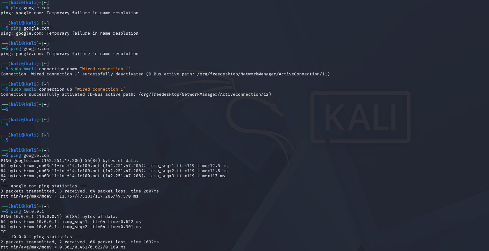

<div align="center">

# 🔐 Cybersecurity Lab Environment Setup
### Building an isolated virtual lab for penetration testing and ethical hacking practice

[](https://github.com)
[](https://github.com)
[](https://github.com)
[](https://github.com)
[](https://github.com)
[](https://github.com)
[](https://github.com)
[](https://github.com)
[](https://github.com)
[](https://github.com)

</div>

---

## 📌 Project Overview
This project details the deployment of a virtual penetration-testing lab using Oracle VirtualBox and Kali Linux. Designed as a controlled, repeatable environment, it facilitates safe network scanning and vulnerability analysis. Built on an isolated private network, the architecture easily accommodates additional target machines for advanced security drills

---

## 🎯 Objectives
The Primary Objective of the project:
- Deploy and configure Oracle VM VirtualBox as the base virtualization platform.
- Provision and initialize a Kali Linux virtual machine within the environment.
- Design and build an isolated private NAT Network to host the cybersecurity lab.
- Establish robust network connectivity and assign a predictable static IP address to the Kali VM.
- Validate system internet accessibility and DNS name resolution.
- Capture a baseline system snapshot to ensure seamless recovery and state rollback.
- Maintain comprehensive technical documentation of the deployment and network topology.
- Establish a scalable foundation for future security assessments and testing workflows.

---

## 🛡️ Purpose of the Lab
The primary purpose of this lab is to establish a secure, isolated, and fully controlled environment designed for hands-on cybersecurity research, skills development, and authorized security assessments.

Key operational capabilities include:
- Reconnaissance & Footprinting: Conducting network discovery and target mapping.
- Service & Port Scanning: Identifying open ports, active services, and OS fingerprints.
- Vulnerability Assessment: Scanning and analyzing systems for security weaknesses.
- Traffic & Packet Analysis: Inspecting network protocol flows and payload data.
- Web Application Testing: Evaluating web application security postures against common threat vectors.
- Offensive Security Practice: Executing controlled exploitation scenarios and proof-of-concept attacks.
- Tooling & Methodology Evaluation: Testing and fine-tuning cybersecurity utilities and defensive workflows.

> ⚠️ **Important:** This laboratory must only be used for systems that you own or have explicit permission to test. Do not use the lab or its tools to attack unauthorized systems.

---

## 🏗️ Lab Architecture
Additional target machines can be added to the same virtual network in future projects.

---

## ⚙️ Lab Configuration

| 🧩 Component | ⚙️ Configuration Details |
| :--- | :--- |
| 🖥️ Host OS | Windows 11 |
| 🧠 Host RAM | 32 GB |
| 🧰 Hypervisor | Oracle VirtualBox 7.2.22 |
| 🐉 Security OS | Kali Linux v2026.3 |
| 🧠 Kali RAM | 2048 MB |
| 🌐 Virtual Network | NAT Network |
| 📡 Network Address | 10.0.0.0/24 |
| 🐧 Kali IP Address | 10.0.0.2/24 |
| 🚪 Default Gateway | 10.0.0.1 |
| 🌍 DNS Server | 8.8.8.8 |
| 🔮 Future VM Range | 10.0.0.3–10.0.0.99 |

---

## 🪜 Lab Setup Procedure

### Step 1. Install 7-Zip
Install 7-Zip to extract the Kali Linux virtual machine package, which may be distributed as a `.7z` archive.
* **Tool:** 7-Zip

---

### Step 2. Install VirtualBox
VirtualBox was installed as the hypervisor.

> *Description: Oracle VirtualBox hypervisor installation files.*

---

### Step 3. Create the NAT Network
Create a dedicated NAT Network in VirtualBox.
* **Configuration:**
  * **Network Name:** `NatNetwork`
  * **IPv4 Prefix:** `10.0.0.0/24`
  * **DHCP:** Enabled
  * **IPv6:** Disabled

* **Rationale for NAT Network Architecture:**
We selected a custom NAT Network to create an isolated, shared virtual subnet for the lab.

  * **Inter-VM Communication:** Allows attacker and target virtual machines to seamlessly discover and communicate with each other    within a controlled environment.

  * **Outbound Access:** Enables lab endpoints to reach the internet for package updates, tool downloads, and system patches.

  * **Containment:** Protects the host and physical network by blocking unsolicited inbound traffic from entering the lab.
  
  
> *Description: VirtualBox NAT Network configuration showing the 10.0.0.0/24 IP prefix.*

---

### Step 4. Import Kali Linux
The Kali Linux virtual machine was downloaded from the official Kali Linux website and imported into VirtualBox.
The VM network adapter was configured as follows:
* **Adapter 1:**
  * Attached to: NAT Network
  * Network: `NatNetwork`
  * Adapter Type: Intel PRO/1000 MT Desktop
* **Allocations:**
  * RAM: 2048 MB


 
> *Description: VM Network Adapter and system settings mapping to the lab network.*

---

### Step 5. Configure the Kali Linux Network
The Kali Linux network configuration was checked and configured with a consistent IPv4 address.
* **Example configuration:**
  * **IP Address:** `10.0.0.2`
  * **Subnet Mask:** `255.255.255.0`
  * **Gateway:** `10.0.0.1`
  * **DNS:** `8.8.8.8`

A consistent IP address makes it easier to document the lab and reference the Kali machine in future exercises.
 
> *Description: Assigning Kali VM IP within the NAT network IP pool.*
---

## Step 6. Enabling Clipboard and File Drag-and-Drop Features
The bidirectional clipboard and drag-and-drop features were enabled to ensure that files and text can be easily copied between the host and the VM.

   
> *Description: Enabling seamless file sharing between VM and Host through copy and paste and drag-and-drop features on VirtualBox*

---

### Step 7. Create a shared folder
To streamline workflows, a VirtualBox Shared Folder was configured between the host operating system and the Kali Linux VM. The directory is automatically mounted within the guest environment at `/media/sf_<folder_name>`, granting the VM secure local access to files on the host machine. This eliminates the need for network-based file transfers when moving utility scripts, tool updates, or project documentation into the lab.


> *Description: Creating a shared folder that a VM can access from the host.*
---

### Step 8. Create a Clean VM Snapshot
Upon completing the initial network and system configuration, a VirtualBox snapshot was captured to establish an immutable baseline for the lab.

* **State Preservation:** Preserves the OS, network configuration, and installed utilities in a known-good, non-degraded state.

* **Rapid Rollback:** Enables instant restoration back to this clean state if subsequent security testing, misconfigurations, or malware execution disrupt system functionality.

* **Operational Efficiency:** Eliminates the need to reinstall or reconfigure the virtual machine for future exercises.

> *Description: Creating a snapshot as best practice to ensure the system can be restored during failure.*

---

## 🔎 Lab Verification

Verify that your environment functions properly using the commands below:

| ✅ Test | 🧾 Command | 🎯 Expected Result |
| :--- | :--- | :--- |
| 🌐 Check IP address | `ip a` | Correct Kali IP displayed |
| 📡 Test gateway | `ping 10.0.0.1` | Successful replies |
| 🌍 Test Internet connectivity | `ping 8.8.8.8` | Successful replies |
| 🔎 Test DNS resolution | `ping google.com` | Domain resolves |
| 🔄 Verify snapshot | *Restore snapshot and run `ip a`* | Baseline configuration restored |

### Test and verification Results
* **IP Address:** `10.0.0.2/24`
* **Gateway:** `10.0.0.1`
* **DNS:** `8.8.8.8`

> *Description: Testing results to ensure that the VM has intranet and internet communication as well as DNS resolution*
---

## 🐞 Problems Encountered & Solutions
Documenting problems is an important part of the project.

---

### Problem 1. Failing to Install VirtualBox
After extracting the hypervisor installation files, the installer kept saying there is already a running installation, as per the image below.


> *Description: Testing results to ensure that the VM has intranet and internet communication as well as DNS resolution*

* **Workaround used:**
  ```bash
  Get-CimInstance Win32_Process -Filter "Name = 'msiexec.exe'" | Select-Object ProcessId, SessionId, CreationDate, CommandLine
  ```
The command revealed that the MSI was busy; I forced it to stop and disabled all the startup programs since there were updates holding it busy from one of the startup programs. Rebooted and re-ran the installer. 

---

### Problem 2. Internet Connectivity After Static IP Configuration
After manually configuring the IPv4 settings, Internet connectivity failed, the wired NIC icon disappeared, and the loading icon was displayed. The following commands were used to restore connectivity.
* **Workaround used:**
  ```bash
  sudo nmcli connection modify "Wired connection 1" ipv4.dad-timeout 0 
  sudo nmcli connection down "Wired connection 1"
  sudo nmcli connection up "Wired connection 1"

---

## 💡 Key Learnings & Technical Takeaways

Through this project, I gained practical experience in provisioning, networking, and managing virtual infrastructure tailored for hands-on cybersecurity practice. 

### 1. Fundamental Virtualization & System Architecture
* Developing a deep, foundational understanding of hypervisor capabilities and virtualization mechanics.
* Gained hands-on experience in **troubleshooting hypervisor installations** and seeing complex setup challenges through to resolution.

### 2. NAT vs. NAT Network Topology
* **Standard NAT:** Isolates individual guest VMs while routing outbound traffic through the host.
* **NAT Network:** Establishes a shared virtual switch/subnet, enabling multiple lab VMs (such as attacker and target nodes) to communicate internally while retaining outbound Internet access for updates.

### 3. Virtual Machine Networking & IP Configuration
* Configured VirtualBox virtual network adapters and interface settings to manage traffic flows.
* Configured and verified static IPv4 addressing, subnet masks, default gateways, and DNS resolution inside Kali Linux.

### 4. Infrastructure Preservation & Recovery (Snapshots)
* Mastered baseline management by capturing clean VM snapshots prior to experimental or high-risk testing.
* Established a reliable, known-good restoration point to recover quickly from misconfigurations or system damage without reinstalling.

### 5. Documentation & Version Control
* Learned to systematically document terminal commands, configuration steps, network topologies, troubleshooting steps, and visual proofs.
* Adopted **Git and GitHub** workflows to manage project documentation and build a professional cybersecurity portfolio.

---

## 🔐 Security & Ethical Disclaimer
This laboratory environment is designed and operated **strictly for educational, research, and authorized security testing purposes**. All activities conducted within this environment adhere to ethical hacking standards and containment practices.

---

## 🔗 Tools & External Resources
* **7-Zip:** [7-zip.org/download.html](https://7-zip.org/download.html)
* **Oracle VM VirtualBox:** [virtualbox.org/wiki/Downloads](https://virtualbox.org/wiki/Downloads)
* **Kali Linux:** [kali.org/get-kali](https://kali.org/get-kali)

---

## 👤 Author
**Tsepo Maroibaki**  
* Network Operations Center & Cybersecurity   
* Networkwalks Cybersecurity Program (Batch B084)  
* **LinkedIn:** [https://www.linkedin.com/in/tsepo-maroibaki-88234921a](https://www.linkedin.com/in/)  
* **GitHub Repository:** [https://github.com/Maroibakit/NETWORKWALKS-B084-WK1-PM1-CYBERSECURITY-LAB-SETUP/edit/main/README.md](https://github.com/)

---

📌 **Project Metadata:** `Program: Networkwalks Cybersecurity` | `Module: Week 01` | `Project: Lab Setup & Verification`


  
  
  
